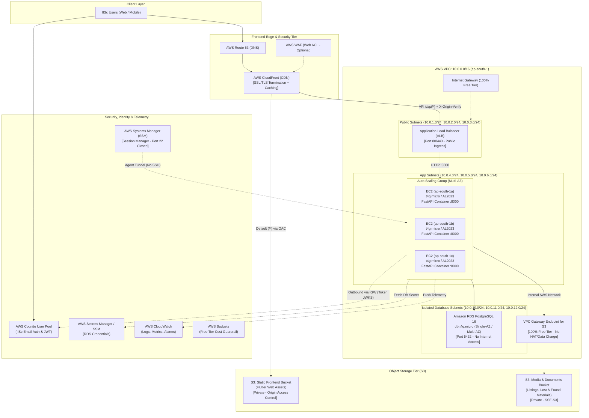

# CampusHub: Baseline Infrastructure Architecture Guide

**Course:** DS252: Introduction to Cloud Computing  
**Project:** CampusHub: An IISc Student Community Platform  
**Team:** Order of Phoenix  
**Target AWS Region:** `ap-south-1` (Mumbai)  
**Architecture Document Revision:** Baseline EC2 Deployment v1.0  

---

## 1. Executive Summary & Evaluation Context

As defined in the **Product Requirements Document (PRD Section 7)**, CampusHub requires an empirical evaluation comparing two distinct cloud deployment paradigms running the exact same backend application codebase:
1. **The Proposed Serverless Architecture:** Amazon API Gateway + AWS Lambda microservices + Amazon RDS PostgreSQL.
2. **The Baseline Infrastructure Architecture:** Amazon CloudFront + Application Load Balancer (ALB) + Amazon EC2 Auto Scaling Group (running containerized FastAPI) + Amazon RDS PostgreSQL.

This document details the **Baseline Infrastructure Architecture**, providing the design rationale, security model, Free Tier cost optimization strategy, and deployment specifications needed to benchmark performance (latency, throughput) and cost against the Serverless deployment.

---

## 2. End-to-End Baseline System Architecture



---

## 3. Core Architectural Concepts & Rationale

### 3.1 What is SSL/TLS Termination and Why is it Relevant?
**SSL/TLS Termination** is the practice of terminating the encrypted HTTPS connection at the edge tier (CloudFront) and forwarding the unencrypted request internally (HTTP port 80/8000) to the backend compute instances.

* **Relevance for Free-Tier EC2:**
  1. **CPU & Memory Offloading:** Cryptographic TLS handshakes (RSA / ECDHE) consume notable CPU cycles. On a Free Tier burstable instance (`t4g.micro` or `t3.micro`), offloading SSL termination to CloudFront frees 100% of the instance's processing budget for application execution and PostgreSQL queries.
  2. **Free, Automated Certificate Lifecycle (ACM):** AWS Certificate Manager provides free, automatically renewing SSL certificates bound to CloudFront. You do not need to manage Certbot, Let's Encrypt cron jobs, or private key rotation on your Linux virtual machines.
  3. **Reduced Latency (Edge Handshake):** CloudFront performs the TLS handshake at the nearest AWS Point of Presence (PoP) in India, drastically reducing Time-to-First-Byte (TTFB) for students.
  4. **Edge Security & WAF Integration:** Decrypting traffic at CloudFront allows AWS WAF to inspect raw HTTP payloads for SQL injection and cross-site scripting (XSS) before requests ever reach the VPC.

---

### 3.2 The Free Tier Network Strategy: Why No Managed NAT Gateway?

A critical design criterion for student and academic projects is **100% adherence to the AWS Free Tier ($0.00/month)**:
* **The Managed NAT Gateway Cost Trap:** An AWS Managed NAT Gateway costs **$0.045/hour + $0.045/GB**, totaling **~$32.40 to $35.00 every month** even when completely idle. In a $50 budget, one NAT Gateway burns over 65% of the total allocation.
* **The Zero-Cost Solution:**
  1. **Internet Gateway (IGW):** An Internet Gateway attached to the VPC costs **$0.00**.
  2. **VPC S3 Gateway Endpoint:** S3 Gateway Endpoints are **100% free** with zero hourly or data-processing charges. All media downloads and uploads from the EC2 backend stay inside AWS's private network.
  3. **Security Group Defense-in-Depth:** Although the App Subnet routes outbound through the Internet Gateway (enabling EC2 to reach Cognito's public JWKS endpoint to verify tokens), **inbound internet access is completely blocked** by AWS Security Groups.
  4. **No Public SSH:** Port 22 is disabled. Remote shell administration is handled securely via **AWS Systems Manager (SSM) Session Manager**, which establishes an encrypted agent tunnel requiring zero open ingress ports.

---

### 3.3 Elimination of API Gateway & VPC Link
In the Serverless deployment, API Gateway HTTP API is required to invoke Lambda functions. For the Baseline EC2 architecture:
* CloudFront routes `/api/*` requests directly to the **Application Load Balancer (ALB)** (or directly to the EC2 backend with an origin verify secret).
* **VPC Link is eliminated**, reducing architectural complexity, eliminating gateway proxy overhead, and matching standard web-tier load balancing conventions.

---

## 4. Key Corrections Applied from the Initial Diagram Draft

During the architecture validation review of the initial baseline diagram (`Baseline-Architecture.jpg`), several critical corrections were identified:

| Diagram Item | Initial Draft Flaw | Corrected Baseline Design | Rationale |
| :--- | :--- | :--- | :--- |
| **API Ingress** | Labeled *"Invokes Function"* pointing directly from API Gateway to EC2 | Replaced with **Application Load Balancer (ALB)** and CloudFront path pattern `/api/*` | EC2 instances are virtual machines, not Lambda functions. API Gateway cannot invoke an EC2 instance without a VPC Link + Load Balancer. |
| **Auto Scaling Group** | ASG enclosed 3 AZs but pinned 5 separate services to individual AZs | ASG launches **uniform instances** running the full FastAPI container (`backend/Dockerfile`) across all AZs | An ASG manages identical instances. Pining distinct services to single AZs creates single points of failure (e.g. AZ 1b failure taking down Placement Hub). |
| **VPC Egress** | Only private subnets shown without NAT or Internet Gateway | Public subnets with an **Internet Gateway (IGW)** added | Private EC2 instances must fetch Cognito's public JWKS keys (`cognito-idp.ap-south-1.amazonaws.com`) to verify student JWTs. |
| **Secrets & Keys** | Labeled *"AWS KMS (Secrets Management)"* | Labeled **AWS Secrets Manager / SSM (Encrypted via AWS KMS)** | KMS handles encryption keys; Secrets Manager and SSM Parameter Store store the actual database credentials. |
| **WebSocket** | Labeled *"AWS API Gateway (HTTPs / WebSocket)"* | Simplified to standard HTTP REST API | CampusHub messaging uses long-polling (`app/routers/chat.py`); WebSockets are planned for a future phase and cannot share a single API Gateway resource with HTTP. |

---

## 5. Security & Isolation Model

```
[CloudFront (Edge)] 
       │
       │ HTTP GET/POST with Header 'X-Origin-Verify: <SECRET>'
       ▼
[ALB Security Group]
       │ Ingress: Allow Port 80/443 ONLY from CloudFront (or all with Header Check)
       │ Egress:  Allow Port 8000 to App-SG
       ▼
[App Security Group (EC2 Instances)]
       │ Ingress: Allow Port 8000 ONLY from ALB-SG
       │ Ingress: Port 22 (SSH) = CLOSED (Admin via SSM Session Manager)
       │ Egress:  Allow Port 5432 to DB-SG
       │ Egress:  Allow Port 443 Outbound (Cognito JWKS, S3 Endpoint)
       ▼
[DB Security Group (RDS PostgreSQL)]
       │ Ingress: Allow Port 5432 STRICTLY from App-SG
       │ Egress:  None (Isolated Database Subnets, No Internet Gateway Route)
```

---

## 6. PRD Evaluation & Load Testing Plan (Locust / k6)

To execute the comparison mandated by **PRD Section 7**:

### 6.1 Workload Generator Setup
* Deploy Locust or k6 on a standalone `c5.large` or `t3.medium` EC2 test harness within `ap-south-1` to eliminate client-side network bottlenecks.
* Replay a representative student usage trace consisting of:
  - 50% Read operations (`GET /api/v1/listings`, `GET /api/v1/notifications`, `GET /api/v1/courses`)
  - 30% Search operations (`GET /api/v1/listings?q=bicycle`, `GET /api/v1/lost-reports`)
  - 20% Write operations (`POST /api/v1/listings`, `POST /api/v1/chat/messages`)

### 6.2 Comparison Metrics Table

| Metric | Serverless (Lambda) | Baseline (EC2 Auto Scaling) | Key Hypothesis |
| :--- | :--- | :--- | :--- |
| **p50 Latency (ms)** | Warm: ~15–25 ms | Persistent: ~8–15 ms | EC2 has zero cold-start overhead and persistent DB connections. |
| **p95 Latency (ms)** | Spikes during cold starts (300–800 ms) | Stable under steady load (< 50 ms) | Lambda experiences cold-start latency when scaling out new concurrent microservices. |
| **Peak Throughput (RPS)** | Scales horizontally up to concurrency quota | Capped by instance vCPU / worker count until ASG triggers scale-out | Lambda scales out faster; EC2 requires ASG cooldown periods (~3–5 mins). |
| **Cost at Low/Idle Load** | **$0.00** (Pay-per-request) | **Fixed instance cost** (24/7 run rate) | Serverless is dramatically cheaper during university vacations and quiet night hours. |
| **Cost at Heavy Load** | Scales linearly with request volume | Amortized across fixed instance capacity | EC2 is more cost-effective under sustained, 100% saturated traffic. |

---

## 7. Baseline Terraform Directory Layout

The baseline infrastructure is organized under `terraform/` on the `baseline-infra` branch:

```
terraform/
├── main.tf                    # Root orchestration (Networking, DB, S3, Cognito, EC2, CDN)
├── variables.tf               # Free Tier configurable parameters
├── outputs.tf                 # CloudFront URL, ALB DNS, DB Endpoint, S3 buckets
├── providers.tf               # AWS Provider (ap-south-1 + us-east-1 for WAF)
├── versions.tf                # S3 Remote State backend configuration
├── modules/
│   ├── networking/            # VPC, Public Subnets, App Subnets, DB Subnets, IGW, S3 Endpoint
│   ├── database/              # RDS PostgreSQL 16 (db.t4g.micro), Parameter Group, Secrets
│   ├── storage/               # Frontend S3 Bucket (Flutter SPA) + Media S3 Bucket
│   ├── auth/                  # Cognito User Pool, Hosted UI Domain, App Client
│   ├── compute_ec2/           # Launch Template, ASG, ALB, User Data, IAM Instance Profile
│   ├── cdn/                   # CloudFront Distribution (Routes S3 + ALB with OAC & Header)
│   ├── monitoring/            # CloudWatch Alarms & AWS Budgets Cost Guardrail
│   └── waf/                   # Optional AWS WAFv2 Web ACL
└── scripts/
    └── deploy_frontend.sh     # Automates Flutter Web build and S3 sync
```
