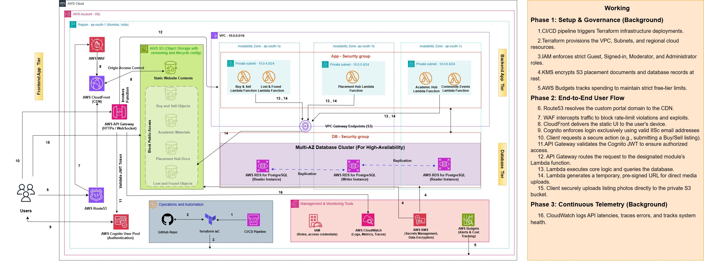
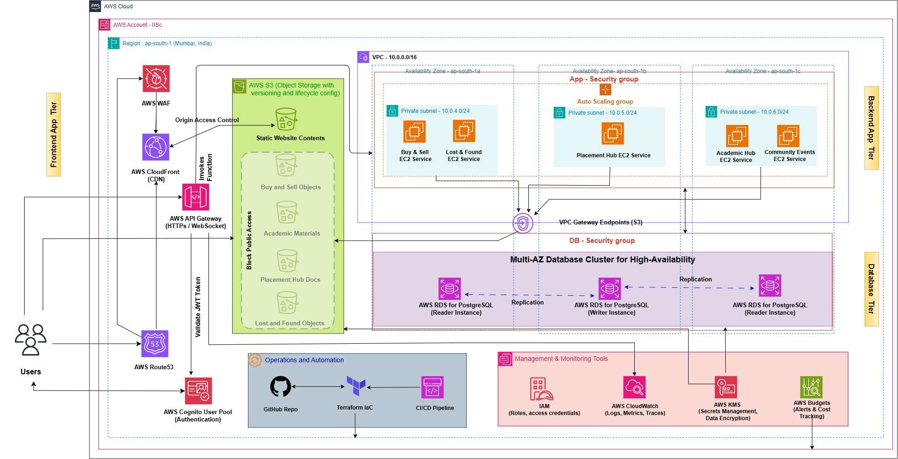

# CampusHub: An IISc Student Community Platform

**Project Requirements Document**

DS252 Introduction to Cloud Computing [Aug 2026], PRD of Order of Phoenix

> This is the Markdown version of the original plan, [`Cloud_Computing_Project-PRD.pdf`](Cloud_Computing_Project-PRD.pdf)
> (v1, 24 October 2026; first issued 30 September 2026 as [`docs/CampusHub-PRD-v1.pdf`](docs/CampusHub-PRD-v1.pdf)).
> The content is unchanged. What was built, and how it differs from this plan, is described in
> [README.md](README.md) and [DEV.md](DEV.md).

| | |
|---|---|
| **Team name** | Order of Phoenix |
| **Team members** | Mohammad Sufyan Azam (SR 26898, mohammadazam@iisc.ac.in) Adithya Chippa (SR 26643, cadithya@iisc.ac.in) Lakhani Dinky Ashokbhai (SR 26648, dinkylakhani@iisc.ac.in) Mukund Kukreja (SR 25862, kmukund@iisc.ac.in) |
| **Summary** | A Cross-platform IISc community Application unifying Buy & Sell, Lost & Found, Academic help, Placement resources, and Campus culture. |
| **Date** | October 24, 2026 |
| **Version** | v1 |

## Table of contents

1. [Problem Statement and Motivation](#1-problem-statement-and-motivation)
2. [Project Scope](#2-project-scope)
3. [Stakeholders and usage scenarios](#3-stakeholders-and-usage-scenarios)
4. [Functional requirements](#4-functional-requirements)
5. [Non-functional requirements](#5-non-functional-requirements)
6. [System architecture and technology stack](#6-system-architecture-and-technology-stack)
7. [Evaluation plan](#7-evaluation-plan)
8. [Work plan, milestones and risks](#8-work-plan-milestones-and-risks)
9. [References](#9-references)

## 1. Problem Statement and Motivation

IISc's roughly 6,000 students currently run the functions of a campus community platform through ad hoc
channels: second-hand Buy & Sell and Lost & Found happen over WhatsApp groups that scroll out of relevance
within days; Course experience and Exam-preparation knowledge is passed down informally between batches and
is rarely documented; and Placement and Interview preparation material lives in scattered personal notes and
one-off senior-junior conversations. Each new cohort effectively rebuilds this institutional knowledge from
scratch, because none of it is searchable, persistent, or structured. The technical gap is the absence of a
single, persistent, filterable, campus-scoped application that verified students can rely on across their
entire programme duration, rather than a rotating set of chat threads.

This problem requires Cloud Infrastructure rather than a single machine for two concrete reasons. First, usage
is bursty and calendar-driven – Buy/Sell spikes at semester start and end, Placement-hub traffic spikes during
Interview season. So, the compute tier needs to scale with dynamic demand rather than being sized (and paid
for) at peak, all year round. Second, the data itself must persist and remain queryable across years of
cohorts (structured search over thousands of listings, reports, and reviews), which needs a managed, durable
database and object store rather than a single machine's disk.

## 2. Project Scope

### 2.1 In scope

- A four-role permission model (Guest, Signed-in User, Moderator, Administrator), enforced independently per
  module.
- Buy & Sell: listings with status tracking (Available/Reserved/Sold), search/filter.
- Lost & Found: separate lost/found reporting flows.
- Academic Help: university wide course feedback/reviews segregated by departments, exam materials and a
  discussion forum for signed-in users.
- Placement Hub: company details, JD, pre-placement-talk (PPT) info, aggregated hiring statistics and past
  trends, interview-experiences, a forum.
- Community/Culture: a category-based events timeline (Past/Present/Upcoming) and the feature to
  bookmark/favorite it to receive alerts.
- Bookmarks: on-device for guest users, account-synced for signed-in users.
- IISc-email-integrated authentication, push notifications, and a cross-platform (website + iOS + Android +
  desktop) client.

### 2.2 Future scope

- In app 1-1 chat feature for messaging between signed-in users.

### 2.3 Out of scope

- In-app payments for Buy & Sell (item handoff and payment remains in-person/off-app).
- Any AI chatbot / Q&A assistant
- Mock-interview-round scheduling.
- Automated (ML-based) content moderation instead of human moderator.
- Support for institutions other than IISc, or multi-campus federation.
- Migration of existing data / posts from WhatsApp groups to our application.
- Any Backup or Disaster recovery drills are out of scope.

### 2.4 Assumptions

- All users authenticate with a valid IISc email address; unauthenticated guests get read-only access.
- The active user base is bounded (roughly 6000 thousand students), which sizes our scale targets.
- Students list/report items honestly. The platform does not verify item ownership or identity beyond email.
- Moderators and Admininstrators are trusted appointees (fellow students/staff). The platform does not defend
  against a malicious Moderator/Administrator.
- AWS Educate/free-tier credits are available to cover the project's cloud spend for the semester. No
  additional credits are sponsored or paid for.
- The resources will be deployed in Mumbai (ap-south-1) region. The timeliness of resources creation and
  service availability are under normal conditions. If a catastrophic event occurs, the resource availability
  and service availability will then be subject to the SLAs of the cloud providers.

## 3. Stakeholders and usage scenarios

### 3.1 User roles and permissions

We have majorly four different categories of users which are enforced per module (ref: FR-2).

1. **Guest user** has read-only permissions. They can bookmark their interests but these bookmarks will be
   stored in their local browser.
2. **Signed-in User** can perform CRUD operations on their own posts/reviews/forum threads/profile. They cannot
   mutate other users information.
3. **Moderators** are module-scoped review authorities. In Buy&Sell/Lost&Found modules, the moderators can
   perform CRUD operations on their own posts and read/delete any other signed-in user's post. In Academic
   Help, there are 2 level of moderators - Department-level and Course level. The Course level moderators are
   optional. Department-level moderators can perform CRUD operations on department scoped materials as well as
   they can CRUD Course-level moderators. On the other hand, Course-level moderators can CRUD any materials on
   the course to which they are assigned.
4. An **Administrator** has access to the entire website. They can perform CRUD operations as well as provision
   or de-provision Moderators.

### 3.2 Usage scenarios

1. **Buy & Sell:** A first-year student searches Buy & Sell for a specific item, filters by price, messages the
   seller, and the seller marks the listing Reserved once they agree.
2. **Lost & Found:** A student loses their ID card near the library and files a Lost report with time and
   location. Two days later, another student finds it and files a Found report. The platform notifies the
   original reporter of a likely match.
3. **Placement Hub:** A final-year student preparing for placements opens the Placement Hub for a specific
   company, reads the JD and recent interview experiences, and checks the last three years' hiring statistics
   before deciding whether to apply.
4. **Academic Help:** A course-level Moderator (appointed by a department-level Moderator) for Academic Help -
   typically a TA or a student who previously took the course - uploads materials (notes, slides, past
   assignments, feedback) from their records and curriculum. A department-level Moderator can freely edit a
   course's materials and feedback, and can also remove the course itself from the department or add new
   courses.

## 4. Functional requirements

| ID | Pri. | Requirement | Acceptance criterion |
|---|---|---|---|
| FR-1 | Must | Sign Up/Log In only with a valid IISc email; Guests browse read-only without an account. | SignUp with a non-IISc email address is rejected before account creation; a Guest session reads public feeds with no login. |
| FR-2 | Must | Enforce the four-role permission matrix (Guest/Signed-in/Moderator/Administrator) independently per module. | An automated test suite covering all role × module combinations confirms every out-of-scope action is rejected with 401/403. |
| FR-3 | Must | An Administrator grants/revokes the Moderator role, scoped to a module (and, for Academic Help, a department or single course). | A revoked Moderator's next privileged call is rejected; a newly granted one succeeds. |
| FR-4 | Must | Create a Buy/Sell listing (title, description, price, category, location, photo). | Listing is retrievable by ID within reasonable time (in seconds) of submission, including the photo and location. |
| FR-5 | Must | Owner changes listing status (Available/Reserved/Sold). | New status visible to other users in near-real time of status update. |
| FR-6 | Should | Search/filter listings by category, price range, keyword. | A combined category + price query returns only matching listings (0 false positives). |
| FR-7 | Must | Submit a lost-item report (description, category, date, location). | Report visible in the Lost feed in near-real time of event reported. |
| FR-8 | Must | Submit a found-item report (description, category, date, location). | Report visible in the Found feed in near real-time – visually distinct from Lost. |
| FR-9 | Should | Notify a lost-item reporter of a found-item report. | For a synthetic matching tag, a push notification is delivered of the found report's creation. |
| FR-10 | Must | A Moderator removes (soft-deletes) any Buy & Sell or Lost & Found post. | Removed post disappears from the public feed in near real-time; a non-owner, non-moderator attempt is rejected (FR-2). |
| FR-11 | Must | Browse departments → courses; see whether feedback/material content exists for a course. | A course with no content returns an explicit "no data yet" response, never an error or blank page. |
| FR-12 | Must | Submit a text course-feedback post tied to a course. | Post visible on the course page in near real-time of feedback submission. |
| FR-13 | Should | Department-level Moderator has full CRUD on their department's courses' materials; course-level Moderator has read+edit+delete only on, on their own course's material. | A course-level Moderator's edit/delete attempt for their own course's material is only accepted; a department-level Moderator's create/update/delete on any course's material in-department succeeds. |
| FR-14 | Should | Post/reply within a course or department discussion forum. | A reply is visible in the thread in near real-time, preserving thread order. |
| FR-15 | Must | Browse a company page: details, JD, PPT information, aggregated hiring statistics. | For available data, returned statistics match the data exactly; missing PPT/JD shows an explicit empty state. |
| FR-16 | Must | Submit an interview-experience post tied to a company/role. | Post visible under the company page. |
| FR-17 | Should | Moderator bulk-imports historical placement records from an existing spreadsheet. | Importing N well-formed rows creates/updates exactly N records; malformed rows are rejected and reported, not silently dropped. |
| FR-18 | Must | Browse events filtered by category/tag (Sports, Food/Mess, Nature, Photography, Culture, etc . . . ). | Filtering by a tag returns only events carrying it. |
| FR-19 | Must | Each event auto-classifies Past/Present/Upcoming by time. | An event with start ≤ now ≤ end shows Present; one past its end time shows Past automatically |
| FR-20 | Should | Bookmark an event; get notified when a bookmarked/followed-tag event updates. | A triggered test update is delivered to the device within the bound set by NFR-1/NFR-2. |
| FR-21 | Must | Landing page surfaces highlights from all four modules. | Each section renders populated content when data exists, and a defined empty-state otherwise. |
| FR-22 | Should | Push notification for events relevant to the user (sale, match, forum reply, bookmarked-event update). | Triggered test event results in a delivered notification within the bound set by NFR-1/NFR-2. |
| FR-23 | Could | One to one personal chat with users | Messages sent by user A intended for user B must reach user B and the acknowledgment should be sent back to user A. |

## 5. Non-functional requirements

| ID | Target (value, unit) | Workload | Measurement method |
|---|---|---|---|
| NFR-1 (Latency) | p99 ≤ 600 ms incl. cold starts, Lambda config. | – | Locust / k6 identical harness – quantifies the serverless trade-off. |
| NFR-2 (Throughput) | ≥50 req/s aggregate, error rate <1%. | Mixed listing - create / search / notification-read traffic, 10-min ramp. | Locust / k6 ramping load. |
| NFR-3 (Scalability) | ≥ 500 concurrent sessions without p99 exceeding NFR-1 by >2×. | Simulated-user count ramp, fixed request mix. | Locust / k6 |
| NFR-4 (High Availability) | ≥ 99.0% over a 2-week window. | Continuous health-check polling. | CloudWatch synthetic canary, 5-min interval. |
| NFR-5 (Cost) | Within free tier credits. | Same load as NFR-1. | AWS Cost Explorer/Budgets over the load-test window. |
| NFR-6 (Identity Security) | 100% of unauth. /expired-token requests and all 16 role × module permission combinations (Guest /Signed-in /Moderator /Administrator × 4 modules) resolve correctly. | Missing / malformed / expired-JWT suite + full permission-matrix suite. | Automated integration test suite, run in CI on every deploy. |
| NFR-7 (Network and Data Security) | TLS 1.2+ in transit; KMS-backed encryption at rest (AWS RDS and S3). | N/A (configuration check). | AWS Config rule / manual audit checklist per milestone. |
| NFR-8 (Data Integrity) | 0% upload corruption. | 100 uploads, 100 KB–10 MB. | Checksum comparison. |

## 6. System architecture and technology stack

*Figure 1: Proposed AWS system architecture illustrating the end-to-end application workflow*

### 6.1 Infrastructure and managed services

- **Edge & delivery:** Route 53 resolves the domain → AWS WAF inspects inbound traffic → CloudFront (CDN)
  serves the static Flutter-web bundle and fronts the API.
- **Storage:** S3 holds the static site plus all module objects (Buy & Sell listings, Lost & Found reports,
  Academic Materials, Placement Hub docs); the bucket is private, reachable only via CloudFront's origin access
  control, and client uploads go directly to S3 through Lambda-signed presigned URLs.
- **Compute & API:** API Gateway (HTTPS/WebSocket) validates the Cognito JWT and invokes per-module Lambda
  functions (Buy&Sell, Lost&Found, Placement Hub, Academic Help, Community Events) running in private subnets
  across three Availability Zones, packaged from the same FastAPI container so it redeploys unmodified to
  Fargate for the Sec. 7 evaluation.
- **Data tier:** AWS RDS (Cluster), reached from the Lambda subnets via direct private subnet routing.–
  persistent records (listings, reports, materials, profiles) and high-write, TTL-expiring data (notification
  and chat streams) alike.
- **Auth & security:** Cognito gates sign-up to IISc email addresses (current student or alumni) and issues
  JWTs carrying Cognito Group claims (Guest/ Signed-in/ Moderator/ Admin, with Moderator groups further scoped
  per department for Academic Help), checked by a single shared FastAPI authorization dependency on every
  route; IAM enforces least-privilege roles per service; KMS manages secrets and encryption at rest.
- **Operations & IaC:** Terraform provisions all of the above from a GitHub-hosted IaC repo, triggered by the
  CI/CD pipeline; CloudWatch collects logs, metrics, and traces; AWS Budgets tracks spend and alerts on cost
  overruns.

### 6.2 Software

- **Flutter:** A single Dart codebase compiles to native iOS/Android/desktop/web-browser build for the
  Frontend.
- **FastAPI (Python):** Async I/O suits concurrent calls to AWS RDS and S3 in one request path, and it packages
  cleanly into a Lambda function via a Lambda-compatible ASGI adapter (e.g. Mangum), which is what lets
  Sec. 7's Lambda-vs-EC2 instances comparison run against the same codebase rather than two separate backends.

### 6.3 Design decisions (alternatives rejected + reason)

| Decision | Alternative rejected | Reason |
|---|---|---|
| Lambda (serverless/FaaS) as sole compute target for FastAPI. | IaaS (EC2) and always-on containers (ECS/Fargate). | Traffic is bursty and calendar-driven (spikes at semester/interview boundaries, idle between). Pay-per-invocation avoids paying for idle capacity and eliminates OS/cluster management overhead. |
| Amazon RDS PostgreSQL Cluster as sole system of record for MVP. | Amazon DynamoDB (NoSQL). | Requires complex multi-attribute filtering (FR-6), hierarchical relational mappings for department-to-course permissions (FR-11, FR-13), and historical spreadsheet ingestion (FR-17). DynamoDB cannot natively handle these relational queries without complex Global Secondary Indexes |
| Flutter for web, desktop, and mobile client. | React Native. | Native rendering (no JS bridge) handles image/scroll-heavy screens smoothly. Single Dart codebase covers all three platforms, avoiding separate frontend stacks. |
| S3 (+ CloudFront) for static website hosting. | Serving from EC2, or via a FaaS handler (Lambda) per request. | Static assets require no compute. S3/CloudFront provides flat per-GB edge hosting without server management. Running through Lambda would add unnecessary compute costs and cold-start latency. |
| Terraform for infrastructure-as-code. | AWS CloudFormation (native IaC). | HCL is more concise than CloudFormation YAML/JSON. terraform plan ensures gives an explicit preview of changes before every apply, and the provider model prevents cloud vendor lock-in for third-party integrations. |

## 7. Evaluation plan

**Workload Generator:** Locust / k6 configured to replay a mixed trace of listing creation, search, and
notification-read traffic.

**Configurations for Comparison:**

*Figure 2: Baseline AWS system architecture illustrating the end-to-end application workflow*

- **Proposed Architecture:** FastAPI application running on AWS Lambda (Serverless), triggered via Amazon API
  Gateway.
- **Baseline Configuration:** The identical FastAPI application packaged in a Docker container and deployed on
  an always-on Amazon EC2 instance.

**Metrics:**

- Client-measured p50, p95, and p99 end-to-end latency (ms).
- System throughput (RPS = requests per second at a < 1% error rate ceiling).
- Cost per 1,000 requests (USD).

**Experimental Configurations Traceability:**

- **Experiment 1: Concurrency and Scalability (Validates NFR-1, NFR-2, NFR-3).** Replay the workload trace
  across both the Lambda and EC2 baseline configurations at three concurrency levels (100, 300, and 500
  simulated clients) with a 10-minute steady-state run.
- **Experiment 2: Cost Efficiency Under Bursty Load (Validates NFR-5).** Simulate a 24-hour campus traffic
  profile featuring sharp semester-boundary traffic spikes followed by idle night hours. Calculate the AWS bill
  (compute + data transfer) for both the Lambda and EC2 configurations over this window.
- **Experiment 3: Permission Matrix Validation (Validates FR-2, NFR-6).** Execute an automated integration test
  suite generating 16 cross-combinations of roles (Guest, Signed-in, Moderator, Admin) attempting CRUD
  operations across all four modules to confirm 100% rejection of unauthorized calls.

**Cost Model:** Total AWS spend (Compute + API Gateway + Database I/O) attributed to the duration of the
load-test window, divided by the total number of successful requests served, expressed as $USD per 1,000
requests.

**Expected Form of Results:**

- A latency-vs-concurrency line plot comparing the Serverless vs. Baseline configurations.
- A cost-per-1,000-requests bar chart demonstrating the idle-cost penalty of the EC2 baseline versus Lambda.

## 8. Work plan, milestones and risks

### 8.1 WBS

| Week/Milestone | Owner | Task |
|---|---|---|
| 1 | All | Finalize PRD; Terraform installation and setup (VPC, S3, etc.); Flutter project skeleton. |
| 2 | All | Auth + 4-role permission model (FR-1, FR-2, FR-3) + profile; FastAPI project skeleton on Lambda. |
| 3 | All | Buy & Sell + Lost & Found (FR-4–FR-10) |
| 4 | All | Academic Help + Placement Hub (FR-11–FR-17) |
| 5 | All | Community/Events/Landing Page (FR-18–FR-22); Permission-matrix test suite (Sec. 7); CI/CD Integration |
| 6 | All | Locust / k6 load tests (Sec. 7); bug-fix pass; demo prep; report writing. |

### 8.2 Minimum Viable Product (MVP)

The MVP delivers the core, persistent campus platform deployed entirely on AWS Lambda and Amazon RDS
(PostgreSQL). It includes:

- **Identity Access:** IISc Email Cognito integration (FR-1) and full Role-Based Access Control (FR-2, FR-3).
- **Core Modules:** Buy Sell CRUD and relational filtering (FR-4, FR-5, FR-6), Lost Found reporting (FR-7,
  FR-8, FR-10), Academic Help course browsing and feedback (FR-11, FR-12),Department level Course information
  access privilege (FR13,FR14) Placement Hub browsing (FR-15, FR-16), and Community Events (FR-18, FR-19,
  FR-21).
- **Infrastructure Base:** Complete Terraform automation of the VPC, Lambda tier, RDS cluster, S3 static
  hosting, and API Gateway.

### 8.3 Stretch Goals (Out of MVP Scope)

- Real-time 1-to-1 Chat via WebSockets (FR-23).
- Automated push notifications for Lost & Found matching (FR-9) and bookmarked events (FR-20, FR-22).
- Moderator bulk-import of historical placement data via Excel spreadsheets (FR-17).

### 8.4 Principal Risks and Mitigations

1. **Risk:** A buggy frontend client loop or accidental request spam floods the API, rapidly consuming the
   team's limited AWS free-tier credits and degrading throughput for legitimate users
   - **Mitigation:** Enable built-in request throttling and quota limits directly in Amazon API Gateway (e.g.,
     a steady-state rate of 50 requests per second and a burst limit of 100). API Gateway intercepts and drops
     excessive requests with an HTTP 429 ("Too Many Requests") status code at the edge before invoking Lambda
     compute, preventing unexpected billing spikes.
2. **Risk:** Generating 500 concurrent simulated clients for the baseline load tests (NFR-3) overwhelms local
   compute resources, leading to false-positive latency metrics caused by client-side CPU bottlenecks rather
   than actual cloud infrastructure limits.
   - **Mitigation:** Instead of running the Locust/k6 workload generator locally, we will deploy the
     load-testing suite onto a dedicated, compute-optimized AWS EC2 instance (e.g., c5.large) in the Mumbai
     region. This guarantees the load generator has sufficient network and CPU overhead to accurately saturate
     and measure the API.
3. **Risk:** Removing DynamoDB to rely strictly on Amazon RDS introduces connection-pool exhaustion if
   thousands of concurrent Lambda instances attempt to open independent database connections during a sudden
   traffic spike (e.g., beginning of placements).
   - **Mitigation:** Implement Amazon RDS Proxy between the Lambda execution tier and the PostgreSQL database.
     RDS Proxy automatically pools and shares a bounded number of database connections, allowing massive
     serverless concurrency to safely multiplex without overwhelming the database's memory.

## 9. References

1. AWS documentation: Lambda, Fargate, API Gateway, RDS, DynamoDB, S3, CloudFront, Cognito, SNS, SQS, KMS,
   Secrets Manager, CloudWatch. https://docs.aws.amazon.com
2. Locust load-testing framework documentation. https://locust.io
3. Grafana k6 load-testing framework documentation https://k6.io/
4. FastAPI documentation. https://fastapi.tiangolo.com
5. Flutter documentation. https://flutter.dev
6. Terraform AWS provider documentation. https://registry.terraform.io/providers/hashicorp/aws
7. Tooling: this PRD's architecture analysis and requirements drafting were iterated on with Claude
   (Anthropic) and Google Gemini, per the course's encouraged LLM use. The architecture diagram is created
   using Draw.io
