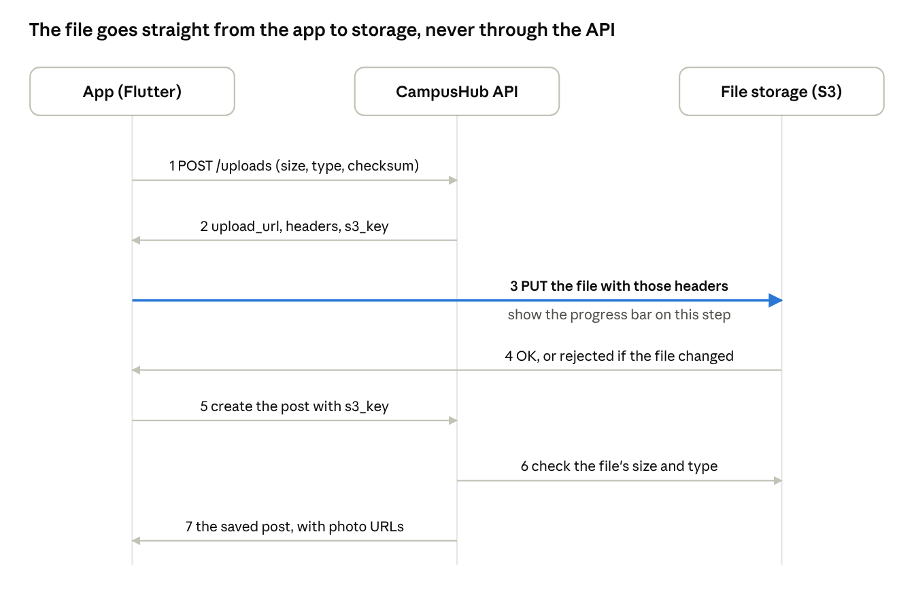

# CampusHub API Reference

Last updated 1 Nov 2026. For the exact JSON of every request and response, run the backend and open Swagger at `http://localhost:8000/docs`.

## Overview

The CampusHub backend exposes 152 endpoints under `/api/v1`. This page lists each one, who may call it, and the fields it takes and returns, so screens can be designed around real data.

- **Base URL (local):** `http://localhost:8000/api/v1`. The cloud host isn't set up yet; only the host part will change.
- **Try it live:** `http://localhost:8000/docs` (Swagger) shows the exact JSON for every request and response, and lets you send real calls.
- **Built so far:** sign-in and profiles, Buy & Sell, Lost & Found, Academic Help, forums, reports and moderation, notifications, messaging, Placement Hub, Community Events and bookmarks.
- **New on 1 Nov 2026 (`backend_v3`):** Placement Hub (companies, JDs, pre-placement talks, hiring statistics, interview experiences, company forums, placement sheet import) and Community Events (tags, Past/Present/Upcoming, bookmarks, followed tags and their alerts). Both have app screens.
- **New on 24 Oct 2026 (from "Taking it further"):** saved searches and alerts, Wanted posts, campus services for the landing page, and the course survival guide. Each has its own section below; the backend is done and the app screens aren't built yet.

The **Who** column in every table below uses these roles:

| Who | Meaning |
| --- | --- |
| guest | Not signed in. Can read every public feed. |
| user | Any signed-in IISc user |
| owner | The user who created the item: seller, reporter or author |
| moderator | A user with an active moderator role for that module, department or course |
| admin | Full access everywhere |

## Sign-in and roles

Guests send nothing. Signed-in users send their token on every call, and the API checks their roles fresh each time.

| Situation | What the app sends |
| --- | --- |
| Guest | No auth header. Every GET feed works. |
| Signed in (cloud) | `Authorization: Bearer <Cognito ID token>` (the ID token, not the access token) |
| Local testing | `X-Dev-User: name@iisc.ac.in`, and optionally `X-Dev-Name: Asha` (works only on the machine running the API) |

- **No sign-up endpoint.** The user's account is created on their first signed-in call.
- **Email must be verified first.** First-time sign-up: the user enters their IISc email and a password, Cognito emails them a code, they type it in, then sign in. Until then the API answers **403** asking them to enter the code.
- **IISc emails only.** Addresses ending in `iisc.ac.in` (including subdomains such as `alum.iisc.ac.in`) are accepted. Others get **403** with a readable message to show the user.
- **Expired or invalid token:** **401** on every endpoint, including pages guests can read. Send the user back to sign-in. **503** means sign-in is briefly unavailable; retry.
- **Role-based screens:** call `GET /me` after sign-in. `is_admin` and `moderator_grants` say which moderator tools to show. Thread detail also returns `viewer_can_moderate`.
- **Roles can change at any time.** A revoked moderator gets **403** on their next call, so handle 403 even on buttons you chose to show.
- **Contact details** (`seller_contact`, `reporter_contact`, `contact`) are `null` for guests, and for posts by deactivated accounts. Design a "Sign in to see contact" state.
- **Deactivated accounts** get **403** on every call. Show "This account has been deactivated".

Moderator roles come in these shapes:

| Module | A moderator covers |
| --- | --- |
| `buy_sell` | All listings |
| `lost_found` | All lost and found reports |
| `academic_help` | One department (all its courses) or one course |
| `placement_hub` | All of Placement Hub: companies, JDs, PPTs, sheet imports, and removing interview experiences and company forum posts |

## Conventions

Every request and response body is JSON, and every list endpoint pages the same way.

- **IDs** are UUID strings, except category IDs, which are integers.
- **Times** are ISO 8601 with a timezone, e.g. `2026-10-23T12:18:55Z`. Show them in IST.
- **Prices** come back as strings in rupees, e.g. `"1500.00"`. Format them as ₹1,500.
- **Removed content** stays in lists where order matters: a removed comment has `removed: true` and `content: null`. Show "This comment was removed".
- **Pages:** list endpoints take `limit` (default 20, max 50) and `offset`, and return `{items, limit, offset, has_more}`. Use `has_more` for "Load more" or infinite scroll; there's no total count.

Errors return a status code and a `detail` you can show to the user:

| Status | Meaning | Design for |
| --- | --- | --- |
| 200 / 201 | OK / created; the body is the item | Success state |
| 204 | Done, no body (deletes, mark read) | Remove the item from the screen |
| 401 | Not signed in, or the token expired | Sign-in prompt |
| 403 | Signed in but not allowed, or not an IISc email | "You can't do this" message |
| 404 | Item doesn't exist or was removed | Empty or "not found" state |
| 409 | Duplicate (e.g. reporting the same item twice) | Inline message |
| 422 | A field is invalid (including text that is only spaces); `detail` names it | Inline field error |

For 422 from form validation, `detail` is a list of `{loc, msg}`. `loc` ends with the field name, so the error can sit under that field.

## File uploads

Photos and course files go straight from the app to storage, not through the API, so attaching a file takes three calls.

Only step 3 moves the file itself, so that's the step to show progress on.

1. **Ask for an upload ticket:** `POST /uploads` with `kind`, `content_type`, `size_bytes` and `checksum_sha256` (the base64 SHA-256 of the file). Course materials also need `course_id`. The reply has `upload_url`, `headers`, `s3_key` and `expires_in` (900 seconds).
2. **Upload the file:** `PUT` the raw file to `upload_url` with exactly those `headers` (Content-Type, the checksum and `x-amz-tagging`). The file must be exactly `size_bytes` long. Storage rejects a different file type, size or a corrupted file. Show the progress bar on this step.
3. **Attach it:** send the `s3_key` when creating or editing the post: `photo_keys` for listings and lost/found reports, `s3_key` for course materials. The API refuses a key that wasn't uploaded, belongs to someone else, or is already used by another material. Files never attached are deleted after a day.

| `kind` | Allowed types | Max size | Max per post |
| --- | --- | --- | --- |
| `listing_photo`, `lost_report_photo`, `found_report_photo` | JPEG, PNG, WebP, HEIC | 10 MB | 10 photos |
| `course_material` | PDF, PPTX, DOCX, ZIP, TXT, images | 50 MB | 1 file per material |
| `job_description` (Placement Hub moderators only) | PDF, DOCX, TXT | 20 MB | 1 file per JD (`file_s3_key`) |

- **Photo order:** `photo_keys` are kept in the order sent. The first is the cover (`cover_photo_url` in lists).
- **Editing photos later:** `PUT .../photos` with the full new list adds, removes and reorders in one call.
- **Image links** (`url`, `cover_photo_url`, `download_url`) expire after about an hour. Don't save them; fetch the item again.

## Users, profiles and moderators

Ten endpoints cover the signed-in user's profile, other people's public profiles, admin account controls, moderator roles and upload tickets.

| Method | Path | Who | What it does |
| --- | --- | --- | --- |
| GET | `/health` | guest | Health check; returns `{"status": "ok"}` |
| GET | `/me` | user | My profile, `is_admin` and my active `moderator_grants` |
| PATCH | `/me` | user | Edit my `name`, `department_id`, `programme`, `graduation_year`. `phone` only accepts `null` (removes it) |
| POST | `/me/phone/code` | user | `{"phone": "+919876543210"}` (E.164): sends a 6-digit code to that number. No SMS provider yet, so the code is logged; while sign-in codes are hard-coded for testing, it is `123456` |
| POST | `/me/phone/verify` | user | `{"phone", "code"}`: saves the number on my profile and returns it. 401 for a wrong code |
| GET | `/users/{user_id}` | guest | Someone's public profile; `contact` only for signed-in viewers |
| GET | `/users/lookup?email=` | admin | Find an account by email; returns `id`, `email`, `name`, `is_active`, `is_admin`. 404 if nobody with that email has signed in yet. Use it before deactivating or handing over the admin role |
| PATCH | `/users/{user_id}` | admin | Deactivate or reactivate an account: `{"is_active": false}`. Not your own. Returns `id`, `email`, `name`, `is_active`, `is_admin` |
| POST | `/users/{user_id}/make-admin` | admin | Hand the admin role to this user. There is only ever one admin, so the caller becomes a normal signed-in user. 403 for anyone else; 422 for yourself or a deactivated account |
| POST | `/moderators` | admin; department moderator (for their courses) | Make someone a moderator: `email`, `module`, `scope_type`, `department_id` or `course_id` |
| GET | `/moderators` | admin, department moderator | List roles. Filters: `module`, `department_id`, `course_id`, `include_revoked` |
| DELETE | `/moderators/{grant_id}` | same as POST, or the moderator themselves | Revoke a role. A moderator can step down by revoking their own role |
| POST | `/uploads` | user | Get an upload ticket (see File uploads) |

**Fields to design with:**

| Object | Fields |
| --- | --- |
| My profile | `id`, `email`, `name`, `phone` (optional), `department_id`, `programme`, `graduation_year`, `is_admin`, `moderator_grants` (each: `module`, `scope_type`, `department_id`, `course_id`, `granted_at`), `created_at` |
| Public profile | `id`, `name`, `department_id`, `programme`, `graduation_year`, `contact` (`email`, `phone`; signed-in viewers only) |
| Moderator role | `id`, `user_email`, `user_name`, `module`, `scope_type`, `department_id`, `course_id`, `granted_at`, `revoked_at` |

- **Limits:** name 1–100 characters, programme up to 100, graduation year 1950–2100. Send `phone: null` to remove a phone number. A phone number is E.164 (`+` country code and 8–15 digits); Indian (`+91`) numbers have 10 digits starting with 6–9.
- **Granting a role** only works for someone who has signed in at least once; otherwise it returns 404 with a message saying so.

## Buy & Sell

Guests can browse and search listings. Sellers create, edit and mark their own listings, admins can edit any listing, and moderators can remove any listing.

| Method | Path | Who | What it does |
| --- | --- | --- | --- |
| GET | `/buy-sell/categories` | guest | All categories (`id`, `name`), A–Z |
| POST | `/buy-sell/categories` | user | Add a category by `name` (the "Others" option). If the name already exists, ignoring case and spaces, the existing one comes back |
| GET | `/listings` | guest | Browse. Filters: `q` (title and description), `category_id`, `min_price`, `max_price`, `status` (repeatable), `seller_id`. `sort`: `newest` (default), `price_asc`, `price_desc` |
| POST | `/listings` | user | Create: `title`, `price`, `category_id`, `description`, `location`, `photo_keys` (up to 10) |
| GET | `/listings/{id}` | guest | One listing with all photos; `seller_contact` for signed-in users |
| PATCH | `/listings/{id}` | owner, admin | Edit `title`, `description`, `price`, `category_id`, `location` |
| PATCH | `/listings/{id}/status` | owner, admin | Set `status`: `available`, `reserved` or `sold` |
| PUT | `/listings/{id}/photos` | owner, admin | Replace the photo list: `photo_keys` in the new order |
| DELETE | `/listings/{id}` | owner, Buy & Sell moderator, admin | Remove. Moderators can add `?reason=` |

**Fields to design with:**

| Object | Fields |
| --- | --- |
| Listing card (in lists) | `id`, `title`, `price`, `status`, `location`, `category` (`id`, `name`), `seller` (`id`, `name`), `cover_photo_url`, `created_at` |
| Listing detail | Everything on the card, plus `description`, `photos` (each: `url`, `sort_order`), `seller_contact` (`email`, `phone`; `null` for guests), `updated_at` |

- **Limits:** title 1–120 characters, description up to 5,000, location up to 200, price ≥ 0, category name 1–50.
- **Sold items:** browse returns every status unless you filter. To hide sold items, send `status=available&status=reserved`.
- **My listings:** browse with `seller_id` set to my own `id` from `GET /me`.

## Lost & Found

Lost reports and found reports have identical endpoints. Swap `/lost-reports` for `/found-reports` in every row below.

| Method | Path | Who | What it does |
| --- | --- | --- | --- |
| GET | `/lost-found/categories` | guest | All categories, A–Z. A category names the item: ID card, Water bottle, Earbuds |
| POST | `/lost-found/categories` | user | Add a category by `name`, or get the existing one with that name |
| GET | `/lost-reports` | guest | Browse. Filters: `q` (description), `category_id`, `status` (repeatable), `reporter_id`, `from_date` and `to_date` (when the item was lost or found; send a time zone). `sort`: `newest` (default) or `oldest`, by when the report was filed |
| POST | `/lost-reports` | user | File a report: `description`, `category_id`, `occurred_at`, `location`, `photo_keys` (up to 10). The reply includes `possible_matches` |
| GET | `/lost-reports/{id}` | guest | One report with photos; `reporter_contact` for signed-in users |
| PATCH | `/lost-reports/{id}` | owner, admin | Edit `description`, `category_id`, `occurred_at`, `location` |
| PATCH | `/lost-reports/{id}/status` | owner, admin | Set `status`: `open` or `closed` |
| PUT | `/lost-reports/{id}/photos` | owner, admin | Replace the photo list |
| DELETE | `/lost-reports/{id}` | owner, Lost & Found moderator, admin | Remove. Moderators can add `?reason=` |
| GET | `/lost-reports/{id}/matches` | owner, admin | Possible matches for your own report, best first (up to 10). Anyone else gets 403 |

**Fields to design with:**

| Object | Fields |
| --- | --- |
| Report card (in lists) | `id`, `kind` (`lost` or `found`), `description`, `category`, `occurred_at`, `location`, `status`, `reporter` (`id`, `name`), `cover_photo_url`, `created_at` |
| Report detail | Everything on the card, plus `photos`, `reporter_contact` (`null` for guests), `updated_at` |
| Create reply only | `possible_matches`: up to 10 open reports of the other kind, same category, by other people, with compatible times (kept for older clients; use `/matches` instead) |
| Matches reply | `status`: `ready`, `pending` (still being matched: ask again in ~2 s) or `unavailable` (no matcher on this server: same-category reports, unranked). `matches`: list of `report` (a card), `score` (0–1), `strength` (`strong` or `possible`; `null` when unavailable), `reasons` (e.g. "Similar description", "Similar photo", "Photo fits the description", "Same category") |

- **`occurred_at`** is when the item was lost or found, as entered by the user. It's separate from `created_at`, so the form needs a date-and-time picker.
- **Matching:** every new report is compared, in the background, with open reports of the other kind by someone else, lost no later than a day after the item was found, in **any** category. It compares the descriptions, the photos, and each description with the other report's photos (three small embedding models; future plan §1.2). Pairs that score as possible are listed under `/matches`. A **strong** pair sends the lost report's owner a `lost_found_match` notification (`found_report_id`, `lost_report_ids`, `message`), whichever report came second. Editing the description, category or time, replacing photos, or reopening matches again. Nobody is notified twice about the same found report.
- **Without the matcher** (a server without the models): filing a found report notifies everyone with an open lost report in that category, lost on or before that time, and `/matches` answers `unavailable`.
- There is no `matched` status (removed in rev 11): a report stays `open` until its owner closes it.
- **Limits:** description 1–2,000 characters, location up to 200, up to 10 photos.

## Wanted posts

A buyer says what they need ("Need a cycle, budget ₹3,000") instead of waiting for it to be listed. Suits a "Wanted" tab in Buy & Sell.

| Method | Path | Who | What it does |
| --- | --- | --- | --- |
| GET | `/wanted` | guest | Browse, newest first. Filters: `q` (title and description), `category_id`, `status` (repeatable; default `open` only), `author_id` |
| POST | `/wanted` | user | Post one: `title`, `category_id` (a Buy & Sell category), `description`, `max_price` (leave out for "open to offers"). The reply includes `possible_matches` |
| GET | `/wanted/{id}` | guest | One post; `author_contact` for signed-in users |
| GET | `/wanted/{id}/matches` | guest | Up to 10 available listings that match the post, best first (listing cards) |
| PATCH | `/wanted/{id}` | owner, admin | Edit `title`, `description`, `category_id`, `max_price` |
| PATCH | `/wanted/{id}/status` | owner, admin | Set `status`: `open`, `fulfilled` (got it) or `closed` (no longer needed) |
| DELETE | `/wanted/{id}` | owner, Buy & Sell moderator, admin | Remove. Moderators can add `?reason=` |

**Fields to design with:**

| Object | Fields |
| --- | --- |
| Wanted card (in lists) | `id`, `title`, `category` (`id`, `name`), `max_price` (`null` = open to offers), `status`, `author` (`id`, `name`), `created_at` |
| Wanted detail | Everything on the card, plus `description`, `author_contact` (`null` for guests), `updated_at` |
| Create reply only | `possible_matches`: listing cards that already match |

- **Matching:** a listing matches when it's available, in the same category, at or under `max_price`, and shares at least one word with the post's title ("Need a Hero cycle" matches "Hero Sprint 26T"). Each new or edited listing that matches sends the author a `wanted_post_match` notification, once per listing.
- **Sellers** can browse `GET /wanted?category_id=` to see demand before listing.
- **Limits:** title 1–120 characters, description up to 2,000, up to 10 open posts per person (an 11th returns 409).

## Saved searches and alerts

"Tell me when a cycle under ₹3,000 appears", or "when someone finds an ID card". Put a "Save this search" button on the Buy & Sell and Found-items search screens, and a "Saved searches" list under the profile.

| Method | Path | Who | What it does |
| --- | --- | --- | --- |
| GET | `/me/saved-searches` | user | My saved searches, oldest first, each with `new_count` |
| POST | `/me/saved-searches` | user | Save one: `module`, `name`, and the filters (`q`, `category_id`, `min_price`, `max_price`), plus `alerts_enabled` (default `true`) |
| PATCH | `/me/saved-searches/{id}` | owner | Change `name`, filters or `alerts_enabled`. Send `null` to clear a filter |
| POST | `/me/saved-searches/{id}/seen` | owner | The user opened the results: resets `new_count` to 0 |
| DELETE | `/me/saved-searches/{id}` | owner | Delete it; its alerts stop |

**Fields to design with:**

| Object | Fields |
| --- | --- |
| Saved search | `id`, `module` (`buy_sell` or `lost_found`), `name`, `q`, `category_id`, `category_name`, `min_price`, `max_price`, `alerts_enabled`, `new_count`, `last_seen_at`, `created_at`, `updated_at` |

- **`buy_sell` searches watch new listings; `lost_found` searches watch new found reports.** Lost & Found searches have no price filter (422 if sent).
- **Showing the results:** call `GET /listings` (or `GET /found-reports`) with the same `q`, `category_id`, `min_price` and `max_price`. They mean exactly the same thing there. Then call `/seen`.
- **Alerts:** a new matching item (or one edited or made available again so it now matches) sends a `saved_search_match` notification, once per item, never for your own posts. Turn alerts off with `alerts_enabled: false`; `new_count` still updates.
- **Limits:** name 1–80 characters, `q` up to 200, up to 20 saved searches per person (a 21st returns 409).

## Placement Hub

Company pages for placement prep (FR-15, FR-16, FR-17): what the company does, its JDs, pre-placement talks (PPTs), how many students it selected each year, seniors' interview experiences, and a forum.

| Method | Path | Who | What it does |
| --- | --- | --- | --- |
| GET | `/companies` | guest | Browse companies. Filters: `q` (name or industry), `industry`. `sort`: `name` (default), `most_hired` (latest season's hires), `upcoming_ppt` (soonest talk first) |
| GET | `/companies/{id}` | guest | The company page: details, `job_descriptions`, `ppts`, headline numbers, `viewer_can_manage` |
| POST | `/companies` | placement moderator, admin | Add one: `name`, `industry`, `website` (must start with `https://` or `http://`), `description`. A name that differs only in case or spacing is a duplicate (409) |
| PATCH | `/companies/{id}` | placement moderator, admin | Edit any of those fields |
| DELETE | `/companies/{id}` | admin | Delete it **with** its JDs, PPTs, hiring records, interview experiences and forum |
| POST | `/companies/{id}/jds` | placement moderator, admin | Add a JD: `role_title`, `description` (the JD text), `compensation` (free text, e.g. "₹32 LPA"), optional `file_s3_key` (upload kind `job_description`: PDF, DOCX or TXT, up to 20 MB) |
| PATCH | `/jds/{id}` | placement moderator, admin | Edit; `file_s3_key: null` removes the file |
| DELETE | `/jds/{id}` | placement moderator, admin | Delete a JD |
| GET | `/placement/ppts` | guest | PPTs across companies. `when`: `upcoming` (default, soonest first), `past`, `all` |
| POST | `/companies/{id}/ppts` | placement moderator, admin | Add PPT info: `details`, `venue`, `scheduled_at` (leave out until the date is announced). At least one is needed |
| PATCH / DELETE | `/ppts/{id}` | placement moderator, admin | Edit or delete PPT info |
| GET | `/companies/{id}/hiring-stats` | guest | Students selected per year and role, newest year first |
| GET | `/placement/stats` | guest | Seasons at a glance: hires and companies per year (`years`, default 5) and the top recruiters of the latest season (or `year`) |
| GET | `/interviews` | guest | Interview experiences, newest first. Filters: `company_id`, `q`, `role`, `placement_year`, `mine=true` (signed in) |
| POST | `/companies/{id}/interviews` | user | Share one: `role_title`, `content`, `placement_year`, `is_anonymous` |
| GET | `/interviews/{id}` | guest | One interview experience |
| PATCH | `/interviews/{id}` | owner, admin | Edit. Only the author can change `is_anonymous` |
| DELETE | `/interviews/{id}` | owner, placement moderator, admin | Remove. Moderators can add `?reason=`; open reports on it close |
| GET | `/companies/{id}/forum` | guest | The company's forum (created on first visit). Threads and replies use the Forums endpoints below |
| POST | `/placement/imports` | placement moderator, admin | Import a placement sheet (FR-17): `placement_year` and `sheet` (see below) |
| GET | `/placement/imports` | placement moderator, admin | Past imports, newest first, with their counts |

**Fields to design with:**

| Object | Fields |
| --- | --- |
| Company card (in lists) | `id`, `name`, `industry`, `description`, `role_count`, `interview_count`, `next_ppt_at`, `latest_year`, `latest_year_selected`, `total_selected` |
| Company page | Everything on the card, plus `website`, `job_descriptions`, `ppts`, `viewer_can_manage`, `created_at`, `updated_at` |
| JD | `id`, `company_id`, `role_title`, `description`, `compensation`, `file_s3_key`, `file_url` (short-lived link, `null` without a file) |
| PPT | `id`, `company_id`, `company_name`, `details`, `venue`, `scheduled_at`, `when` (`upcoming`, `past`, `unscheduled`) |
| Hiring stats | `company_id`, `company_name`, `total_selected`, `years`: [`year`, `students_selected`, `roles`: [`role_title`, `students_selected`]] |
| Interview experience | `id`, `company_id`, `company_name`, `role_title`, `placement_year`, `content`, `is_anonymous`, `is_mine`, `author` (`null` for guests, and for anonymous posts except to their author) |
| Import result | `id`, `placement_year`, `rows_total`, `rows_created`, `rows_updated`, `rows_rejected`, `companies_created`, `rejected_rows`: [`line`, `reason`], `imported_at` |

- **Empty states (FR-15):** a company with no JD or PPT returns empty lists, and one with no hiring data has `latest_year: null` and `years: []`. Show "No job description posted yet", never an error.
- **Hiring statistics are totals only.** Placement records hold students' emails, but no endpoint returns them.
- **Sheet import:** the moderator pastes the sheet as text: cells copied from a spreadsheet (tab-separated) or a CSV export. The first line is the header: `Company`, `Student email`, `Role`, and optionally `Slot`, in any order (a few common spellings like `Email` or `Designation` work). Each row is created, updated (the same student's email in the same season), or rejected with its line number and reason; good rows import even when others are rejected. Companies are matched by name ignoring case and spacing, and new ones are created. The pasted text is stored in S3 as the import's source. Up to 5,000 rows; a sheet with no usable header returns 422 and imports nothing.
- **Reporting:** interview experiences and company forum posts can be reported (`interview_experience`, `thread`, `comment`); they go to the Placement Hub moderators' queue.

## Community Events

A campus events timeline (FR-18, FR-19, FR-20): sports, culture, talks, food and more. Anyone signed in can post an event; its organizer (or an admin) edits or cancels it. Events have no moderators of their own.

| Method | Path | Who | What it does |
| --- | --- | --- | --- |
| GET | `/event-tags` | guest | All tags with `upcoming_count` and, for signed-in users, `following` |
| POST | `/event-tags` | admin | Add a tag: `name` |
| PATCH / DELETE | `/event-tags/{id}` | admin | Rename or delete a tag |
| GET | `/events` | guest | The timeline. Filters: `when` (repeatable `present`, `upcoming`, `past`; default present + upcoming), `tag_id` (repeatable; events with any of them), `q` (title, description, place), `from_time` / `to_time`, `organizer_id`, `bookmarked=true` (signed in) |
| GET | `/events/{id}` | guest | One event |
| POST | `/events` | user | Post one: `title`, `start_time`, `end_time` (with a timezone), `tag_ids` (1–5), `location`, `description` |
| PATCH | `/events/{id}` | organizer, admin | Edit any field, including `tag_ids` |
| DELETE | `/events/{id}` | organizer, admin | Cancel (remove) it |
| GET | `/me/followed-tags` | user | Tags I follow |
| PUT / DELETE | `/me/followed-tags/{tag_id}` | user | Follow / unfollow a tag (204). Following twice is fine |
| GET | `/me/bookmarks` | user | My bookmarks (`target_type` `listing` or `event`, optional filter), newest first; removed items drop out |
| PUT / DELETE | `/me/bookmarks/{target_type}/{id}` | user | Bookmark / un-bookmark a listing or event. Bookmarking twice is fine |
| POST | `/me/bookmarks/import` | user | `{"items": [{"target_type", "target_id"}, ...]}` (up to 500): save a guest's on-device bookmarks after sign-in. Returns `added`, `already_saved`, `skipped` (no longer exists) |

**Fields to design with:**

| Object | Fields |
| --- | --- |
| Event | `id`, `title`, `description`, `location`, `start_time`, `end_time`, `when` (`upcoming`, `present`, `past`), `tags` (`id`, `name`), `organizer` (`id`, `name`), `bookmark_count`, `is_bookmarked`, `can_edit`, `created_at`, `updated_at` |
| Tag | `id`, `name`, `upcoming_count`, `following` |

- **Past / Present / Upcoming (FR-19)** is worked out from the clock on every request: `present` when start ≤ now ≤ end. The default order is happening now, then soonest upcoming, then most recent past.
- **Guests' bookmarks** stay on the device (PRD §3.1). The app keeps them locally and calls `/me/bookmarks/import` once the person signs in.
- **Alerts (FR-20, FR-22):** a new event alerts everyone following one of its tags (`followed_tag_event`); adding a followed tag to an existing event does too. Changing an event's time, place, title or details, or cancelling it, alerts everyone who bookmarked it (`bookmarked_event_update`, with `cancelled: true` for a cancellation). Nobody is alerted about their own changes, or about events that are already over.
- **Limits:** title 1–150 characters, an event lasts at most 30 days and starts at most about a year ahead, up to 5 tags.

## Academic Help

The screens go department → course → materials and feedback. Each course and department also has a forum (next section).

| Method | Path | Who | What it does |
| --- | --- | --- | --- |
| GET | `/departments` | guest | All departments, A–Z, with `course_count` |
| POST | `/departments` | admin | Add a department: `name` |
| PATCH | `/departments/{id}` | admin | Rename it |
| DELETE | `/departments/{id}` | admin | Delete it and everything inside (courses, materials, feedback, forums) |
| GET | `/departments/{id}/courses` | guest | Its courses, sorted by code, with counts and `has_content` |
| POST | `/departments/{id}/courses` | admin, department moderator | Add a course: `code`, `name` |
| GET | `/courses/{id}` | guest | One course |
| PATCH | `/courses/{id}` | admin, department moderator | Edit `code`, `name` |
| DELETE | `/courses/{id}` | admin, department moderator | Delete it and everything under it |
| GET | `/courses/{id}/materials` | guest | Materials, newest first. Filter: `material_type` |
| POST | `/courses/{id}/materials` | course moderator (that course), department moderator, admin | Add one: `title`, `material_type`, `s3_key` |
| PATCH | `/materials/{id}` | same | Edit `title`, `material_type` |
| DELETE | `/materials/{id}` | same | Remove. Optional `?reason=` |
| GET | `/courses/{id}/feedback` | guest | Feedback, newest first. Author names are shown only to signed-in viewers, and never for anonymous feedback |
| GET | `/courses/{id}/feedback/mine` | user | My review of this course; 404 if I haven't written one |
| POST | `/courses/{id}/feedback` | user | Post a review: `content`, `is_anonymous` (default false). One review per person per course: a second one returns 409 "You've already reviewed this course. Edit your feedback instead." |
| PATCH | `/feedback/{id}` | owner, department moderator, admin | Edit `content`; only the author may change `is_anonymous` |
| DELETE | `/feedback/{id}` | owner, course moderator (that course), department moderator, admin | Remove. Optional `?reason=` |

**Fields to design with:**

| Object | Fields |
| --- | --- |
| Department | `id`, `name`, `course_count`, `created_at` |
| Course | `id`, `department_id`, `code`, `name`, `material_count`, `feedback_count`, `has_content`, `created_at` |
| Material | `id`, `course_id`, `title`, `material_type`, `download_url`, `uploaded_by` (`id`, `name`), `created_at` |
| Feedback | `id`, `course_id`, `author` (`id`, `name`; `null` for guests and for anonymous feedback, except to its author), `is_anonymous`, `is_mine` (the viewer wrote it: show Edit and Delete), `content`, `created_at`, `updated_at` |

- **Empty courses:** `has_content: false` means show "No data yet".
- **Material types:** `notes`, `slides`, `past_assignment`, `exam_material`, `other` (the default). These suit filter chips.
- **Who sees upload and edit buttons:** check `moderator_grants` from `GET /me` for this course or its department.
- **Limits:** department name 1–120 characters, course code 1–20, course name 1–200, material title 1–200, feedback 1–5,000.

### Course survival guide

A one-page summary of a course's feedback, semester by semester, with sentiment over time. It's a read-only page on the course screen; there's nothing to post.

| Method | Path | Who | What it does |
| --- | --- | --- | --- |
| GET | `/courses/{id}/survival-guide` | guest | The guide, computed from the course's feedback when requested |

| Object | Fields |
| --- | --- |
| Guide | `course` (`id`, `code`, `name`, `department_id`, `department_name`), `feedback_count`, `summary` (a ready-to-show paragraph), `overall` (a Sentiment, `null` with no feedback), `trend` (`improving`, `declining`, `steady`, `not_enough_data`), `themes` (each a Theme), `advice` (up to 5 tips students repeat), `semesters` (oldest first), `method`, `generated_at` |
| Semester | `term` (e.g. `Aug 2025`), `starts_on`, `in_progress`, `feedback_count`, `sentiment`, `top_themes` (up to 3), `highlights` (`positive`, `negative`: one quoted sentence each, or `null`) |
| Sentiment | `score` (-1 to +1), `label` (`positive`, `mixed`, `negative`), `positive_share`, `negative_share` (0 to 1) |
| Theme | `theme` (`workload`, `exams`, `assignments and projects`, `teaching`, `grading`, `prerequisites`, `pace and content`), `mentions`, `score`, `label` |

- **Semesters** come from when the feedback was written, in IST: August–December is the "Aug" semester, January–July the "Jan" one. A line chart of `semesters[].sentiment.score` by `term` shows sentiment over time; mark the `in_progress` one as partial.
- **Trend** needs at least 3 finished semesters with 3 or more reviews each; otherwise it's `not_enough_data`.
- **Sentiment** is scored per sentence with a word list built into the backend (`method: "lexicon"`), so it's free and instant. It can later be replaced by Amazon Comprehend or the Ask CampusHub model without changing these fields.

## Forums

Forums go forum → thread → comments. Each course, department and company (Placement Hub) has exactly one forum, created the first time someone opens it.

| Method | Path | Who | What it does |
| --- | --- | --- | --- |
| GET | `/courses/{id}/forum` | guest | The course's forum, with `thread_count` |
| GET | `/departments/{id}/forum` | guest | The department's forum |
| GET | `/companies/{id}/forum` | guest | The company's forum (Placement Hub moderators remove posts there) |
| GET | `/forums/{id}/threads` | guest | Threads, newest first |
| POST | `/forums/{id}/threads` | user | Start a thread: `title` plus `content` (the opening post) |
| GET | `/threads/{id}` | guest | The thread with every comment in order, and `viewer_can_moderate` |
| PATCH | `/threads/{id}` | owner, admin | Rename: `title` |
| DELETE | `/threads/{id}` | owner, forum moderator, admin | Remove the thread and all its comments. Optional `?reason=` |
| POST | `/threads/{id}/comments` | user | Reply: `content` |
| PATCH | `/comments/{id}` | owner, admin | Edit `content` |
| DELETE | `/comments/{id}` | owner, forum moderator, admin | Remove. Optional `?reason=` |

**Fields to design with:**

| Object | Fields |
| --- | --- |
| Thread (in lists) | `id`, `forum_id`, `title`, `author` (`id`, `name`), `comment_count`, `last_comment_at`, `created_at` |
| Thread detail | Everything in the list item, plus `comments` and `viewer_can_moderate` |
| Comment | `id`, `seq`, `author`, `content`, `removed`, `created_at`, `updated_at` |

- **Opening post:** the first comment in `comments`. Edit it like any comment.
- **Removed comments** stay in place with `removed: true` and `content: null`, so replies keep their context.
- **Forum moderators:** for a course forum, that course's moderator or its department's moderator; for a department forum, that department's moderators; admins everywhere. Use `viewer_can_moderate` to show remove buttons.
- **Replies notify** the thread's author and everyone who has commented, except the person replying (`forum_reply`).
- **Limits:** title 1–200 characters, post or comment 1–10,000.

## Reports and moderation

Any signed-in user can flag content. Moderators work through a queue limited to their own scope.

| Method | Path | Who | What it does |
| --- | --- | --- | --- |
| POST | `/reports` | user | Flag an item: `target_type`, `target_id`, `reason` |
| GET | `/me/reports` | user | Reports I've filed, newest first |
| GET | `/reports` | moderator, admin | The queue for my scope, oldest first. Filters: `status` (`open` by default; `actioned`, `dismissed`, or `all`), `module` |
| POST | `/reports/{id}/resolve` | moderator in scope, admin | `action`: `actioned` or `dismissed`, plus an optional `note` and `remove_content` |

**Fields to design with:**

| Object | Fields |
| --- | --- |
| Report | `id`, `module`, `target_type`, `target_id`, `reason`, `status` (`open`, `actioned`, `dismissed`), `reporter` (moderators only), `created_at`, `handled_at`, `resolution_note` |
| Resolve reply | `reports_resolved` (how many reports closed), `content_removed` |

- **What can be flagged** (`target_type`): `listing`, `wanted_post`, `lost_report`, `found_report`, `course_material`, `course_feedback`, `thread`, `comment`. Put a "Report" action on each of these. Wanted posts go to the Buy & Sell queue.
- **One open report per user per item.** A second one returns 409, so show "You've already reported this".
- **The queue has no preview.** Show the item by fetching it with `target_type` and `target_id`, e.g. `GET /listings/{target_id}`.
- **Resolving one report closes every open report on that item.** With `remove_content: true` it also removes the item in the same step. If another moderator resolved it first, you get 409. Removing an item with its DELETE endpoint also closes its reports.
- **Limits:** reason 1–1,000 characters, resolution note up to 1,000.

## Messages (encrypted, not yet end-to-end)

One chat per pair of people, like WhatsApp (since rev 10). What part of a chat is about is a **topic**: a Buy & Sell listing, a lost report or a found report. Each message has at most one topic (none for general chat, e.g. academic help), and an offer always has a listing topic. Messages are encrypted on the sender's device and decrypted on the recipient's, and the API only stores ciphertext. **But the server also holds each user's private key** (no passphrase, so any browser opens messages straight away), so **the server can read chats right now**. Moderators and admins have no way to view them in the app. True end-to-end encryption is planned: see §1.1 of `future-plan-2026-10-31-next-level-features.md`. The Flutter app does the cryptography in `lib/features/messages/crypto/chat_crypto.dart`; `backend/tests/chat_crypto.py` is a reference implementation of the same protocol, and the two are tested to agree byte for byte.

| Method | Path | Who | What it does |
| --- | --- | --- | --- |
| GET | `/me/chat-key` | user | My messaging key: `public_key`, `key_backup`, `backup_kdf`, `backup_salt`, `backup_iterations`. With `backup_kdf` `none` (what the app uses), `key_backup` is the plain 32-byte private key and salt/iterations are `null`; older keys may still have a `pbkdf2-sha256` passphrase backup. 404 until set up. Only ever returned to its owner |
| PUT | `/me/chat-key` | user | Set up messaging (201). The same `public_key` with a new backup only replaces the backup (200), which is how the app moves an old passphrase backup to `none`; a different one replaces the key (201) and messages sent to the old key can't be read any more |
| GET | `/users/{id}/chat-key` | user | Someone's current public key (`id`, `user_id`, `public_key`, `created_at`, `is_current`) |
| GET | `/chat/conversations` | user | My conversations, one per person, most recent first (`limit` up to 100, `offset`). The person who opened a chat sees it at once; the other from the first message |
| GET | `/chat/unread` | user | `{"unread_messages": n, "conversations": n}` for the app-bar badge |
| POST | `/chat/conversations` | user | Exactly one of `listing_id`, `lost_report_id`, `found_report_id` (adds that topic to my chat with its owner) or `user_id` (general chat). Returns `{conversation, topic_id}`: 201 if the chat or topic is new, 200 if both existed. 422 for your own post or yourself, 404 if removed, 403 if either of you blocked the other |
| GET | `/chat/conversations/{id}` | participant | One conversation |
| GET | `/chat/conversations/{id}/messages` | participant | The latest page; `before=<seq>` for older history; `after=<changed_seq>` for every change since (new messages, answered offers, unsent messages). Returns `conversation`, `items`, `keys` (every key the items use) and `has_more` |
| POST | `/chat/conversations/{id}/messages` | participant | Send: `id` (a UUID the app makes), `kind` (`text` or `offer`), `topic_id` (optional; required for an offer, and must be one of this chat's listing topics), `sender_key_id`, `recipient_key_id`, `nonce`, `ciphertext` (base64). 409 if a key changed (reload and re-encrypt); resending the same message returns it (200); 429 after 30 messages a minute |
| POST | `/chat/conversations/{id}/read` | participant | `{"seq": n}`: I've read up to `n` (read receipts and unread counts) |
| POST | `/chat/messages/{id}/offer` | participant | `{"action": "accept" \| "decline" \| "withdraw"}`. Only the other person accepts or declines; only the maker withdraws. Accepting reserves the offer's listing. One open offer per listing: a new one supersedes it |
| DELETE | `/chat/messages/{id}` | sender | Unsend: the ciphertext is erased for both people (a pending offer becomes withdrawn) |
| GET | `/chat/blocks` | user | People I've blocked |
| PUT / DELETE | `/chat/blocks/{user_id}` | user | Block / unblock. A blocked person can't send to you or start chats with you, and isn't told why |

| Object | Fields |
| --- | --- |
| Conversation | `id`, `peer` (`id`, `name`, `is_active`, `key`), `topics` (oldest first), `my_key_id`, `last_seq`, `my_last_read_seq`, `peer_last_read_seq`, `unread_count`, `last_message`, `last_message_at`, `created_at`, `blocked_by_me`, `can_send`, `cant_send_reason` |
| Topic | `id`, `kind` (`listing`, `lost_report`, `found_report`), `ref_id`, `owner_id` (seller or reporter), `title` (listing title, or `Lost: <category>` / `Found: <category>`), `description` (reports), `price` (listings), `status`, `cover_photo_url`, `is_removed`, `started_by`, `created_at` |
| Message | `id`, `conversation_id`, `crypto_context_id`, `topic_id`, `seq`, `changed_seq`, `sender_id`, `kind`, `sender_key_id`, `recipient_key_id`, `nonce`, `ciphertext` (both `null` once unsent), `offer_status` (`pending`, `accepted`, `declined`, `withdrawn`, `superseded`; offers only), `offer_answered_at`, `sent_at`, `deleted_at` |

- **Encryption (protocol `campushub-chat-v1`):** each user has an X25519 key pair. Both people derive an AES-256-GCM key with HKDF-SHA256 from their X25519 shared secret, bound to the message's `crypto_context_id` and both public keys. `crypto_context_id` is the conversation id, except for messages from before rev 10, which keep the id of the per-listing chat they were written in (migration `010_chat_per_person.sql` merged those chats per person). Each message has a random 12-byte nonce, and its associated data binds it to that context, message id, sender and kind, so the server can't move it, relabel the sender, or turn text into an offer. Offer amounts are inside the ciphertext too.
- **Keys for people who haven't opened Messages:** opening a chat (or loading one) gives either person a key if they have none, made on the server with `backup_kdf` `none`, so anyone can be messaged right away.
- **Multiple devices:** the app makes a key on first use and uploads the private key with `backup_kdf` `none`; any other browser the user signs in on downloads it. Nothing to remember, but the server (or anyone with database access) can decrypt messages. Accounts that set a passphrase before it was removed enter it once more on a device that never unlocked it; the app then re-uploads the same key as `none`.
- **Notifications:** `chat_message`, payload `conversation_id` and a `message` saying who wrote about which listing, never the text. One per unread stretch, plus one per offer or offer answer.
- **Also visible to the server:** who talks to whom, about which listing, when, and message sizes are visible to the server. There's no forward secrecy (a stolen private key opens past messages of that key); a Double Ratchet would add it.

## Notifications and devices

Every notification lands in the user's in-app inbox. Push to phones is registered but not delivered yet, so design the inbox first.

| Method | Path | Who | What it does |
| --- | --- | --- | --- |
| GET | `/me/notifications` | user | My inbox, newest first. Filter: `unread_only` |
| POST | `/me/notifications/{id}/read` | user | Mark one read |
| POST | `/me/notifications/read-all` | user | Mark all read; returns `{"updated": <count>}` |
| DELETE | `/me/notifications/{id}` | user | Delete one (204; someone else's id is ignored) |
| POST | `/me/notifications/delete` | user | `{"ids": [...]}` (1–200): delete several; returns `{"deleted": <count>}` |
| DELETE | `/me/notifications` | user | Clear all; returns `{"deleted": <count>}` |
| POST | `/me/devices` | user | Register this device for push: `platform` (`android`, `ios`, `web`, `desktop`) and `push_token` |
| DELETE | `/me/devices` | user | Unregister this device; body `{"push_token": "..."}`. Call it on sign-out |

A notification has `id`, `type`, `payload`, `is_read` and `created_at`. Every `payload` has a ready-to-show `message`; the other fields say where tapping should go.

| `type` | When | `payload` besides `message` | Tap opens |
| --- | --- | --- | --- |
| `forum_reply` | Someone replies in a thread you started or commented in | `thread_id`, `comment_id`, `forum_id` | The thread |
| `lost_found_match` | Someone files a found report matching your open lost report | `found_report_id`, `lost_report_ids` | The found report |
| `saved_search_match` | A new item matches one of your saved searches | `saved_search_id`, and `listing_id` or `found_report_id` | The listing or found report |
| `wanted_post_match` | A new listing matches one of your open Wanted posts | `wanted_post_id`, `listing_id` | The listing |
| `chat_message` | A new message, offer or offer answer, or a buyer wants to chat before you've set up messaging | `conversation_id` | The conversation |
| `followed_tag_event` | A new event carries a tag you follow | `event_id`, `tags` | The event |
| `bookmarked_event_update` | An event you bookmarked changed or was cancelled | `event_id`, `cancelled` | The event (nothing when cancelled) |

- **Unread badge:** call with `unread_only=true` and check whether `items` is empty. There's no unread-count endpoint.
- **Shared devices:** registering a token another account used moves it to the current user.

## Campus services

Health Centre, Wellness Centre, emergency and grievance links for the landing page. The admin manages the list, so links change without an app update.

| Method | Path | Who | What it does |
| --- | --- | --- | --- |
| GET | `/campus-services` | guest | Active services, grouped by `category` (health, wellbeing, grievance, safety, other), then `sort_order`. The admin can add `?include_inactive=true` |
| POST | `/campus-services` | admin | Add one: `name`, `category`, `url` and/or `phone`, `description`, `sort_order`, `is_active` |
| PATCH | `/campus-services/{id}` | admin | Edit any field. `is_active: false` hides it without deleting |
| DELETE | `/campus-services/{id}` | admin | Delete it |

| Object | Fields |
| --- | --- |
| Campus service | `id`, `name`, `description`, `category`, `url` (`null` if phone only), `phone` (`null` if link only), `sort_order`, `is_active`, `updated_at` |

- **Show `phone` as a tap-to-call button** and `url` as a link. Every service has at least one of them.
- **Starting list** (from iisc.ac.in, checked 24 Oct 2026): Health Centre, Emergency / Ambulance (080-2293-4444), Wellness Centre, student grievance redressal, ICASH, complaints about caste-based discrimination, anti-ragging.

## Not available yet

| Area | What's planned |
| --- | --- |
| Landing page highlights | Featured items across modules (FR-21). Campus services links are ready (see Campus services) |
| Push delivery | Devices register today, but pushes are only logged; the inbox works |
