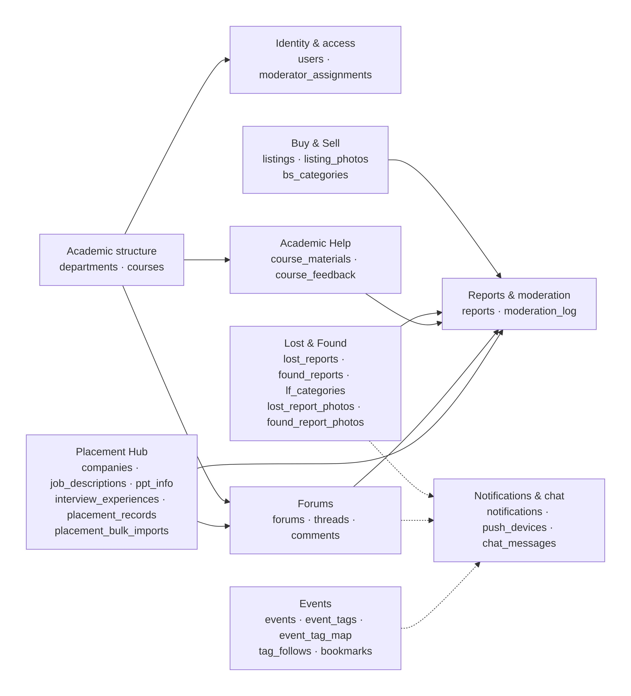

# Database schema

The schema is revision 5, for PostgreSQL 15 or newer: 33 tables, 1 view and 12 enums. The SQL is
[`backend/db/schema.sql`](../../backend/db/schema.sql). Docker Compose loads it the first time the
local database starts.

Each diagram below comes as a PNG (for reading) and an SVG (for zooming in).

| Diagram | Tables | Files |
| --- | --- | --- |
| Overview | Every table, and how the modules connect | [PNG](diagrams/01-overview.png) · [SVG](diagrams/01-overview.svg) |
| Identity and access | departments, courses, users, moderator_assignments | [PNG](diagrams/02-identity-access.png) · [SVG](diagrams/02-identity-access.svg) |
| Buy & Sell | bs_categories, listings, listing_photos | [PNG](diagrams/03-buy-sell.png) · [SVG](diagrams/03-buy-sell.svg) |
| Lost & Found | lf_categories, lost_reports, found_reports and their photos | [PNG](diagrams/04-lost-found.png) · [SVG](diagrams/04-lost-found.svg) |
| Academic Help | course_materials, course_feedback | [PNG](diagrams/05-academic-help.png) · [SVG](diagrams/05-academic-help.svg) |
| Forums | forums, threads, comments | [PNG](diagrams/06-forums.png) · [SVG](diagrams/06-forums.svg) |
| Reports and moderation | reports, moderation_log | [PNG](diagrams/07-reports-moderation.png) · [SVG](diagrams/07-reports-moderation.svg) |
| Placement Hub | companies, job_descriptions, ppt_info, interview_experiences, placement_bulk_imports, placement_records | [PNG](diagrams/08-placement-hub.png) · [SVG](diagrams/08-placement-hub.svg) |
| Events and bookmarks | event_tags, events, event_tag_map, tag_follows, bookmarks | [PNG](diagrams/09-events-bookmarks.png) · [SVG](diagrams/09-events-bookmarks.svg) |
| Notifications and chat | notifications, push_devices, chat_messages | [PNG](diagrams/10-notifications-chat.png) · [SVG](diagrams/10-notifications-chat.svg) |
| Course deletion cascade | What is deleted along with a course | [PNG](diagrams/11-course-deletion-cascade.png) · [SVG](diagrams/11-course-deletion-cascade.svg) |

